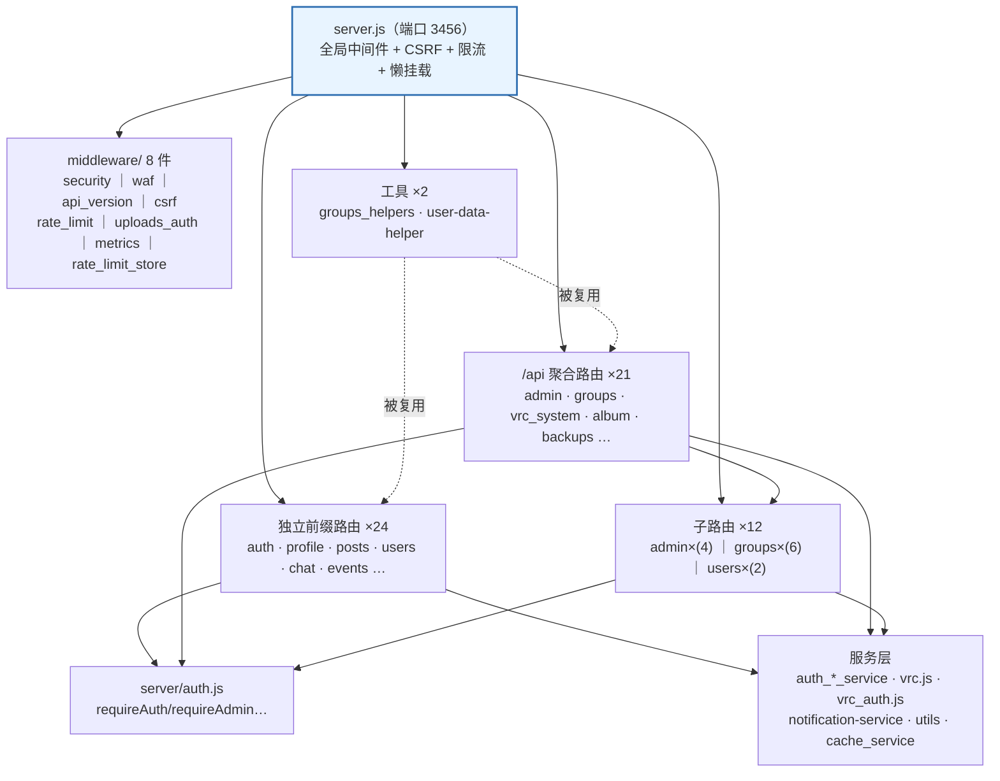
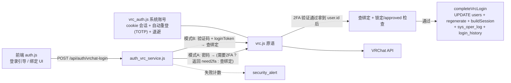

# 13 · 模块地图与依赖关系（详细版）

> 生成日期：2026-10-09（v2 详细版 · M2-M7 后刷新）
> 依据：`server.js` 挂载表逐行核对、`routes/` 59 个文件逐文件盘点、`middleware/` 8 件、`public/js` 47 个文件、`loader.js` 模块表、`index.html` 脚本栈（v=20261011a）、全局符号核对
> 用途：新成员快速理解「入口 → 模块 → 服务 → 契约」的链接关系；**改模块前先看依赖是否被破坏**。
> 关联：[12-审计问题清单-2026-10-09.md](12-审计问题清单-2026-10-09.md)（13 项问题与修复状态）、[09-变更记录.md](09-变更记录.md）

**一句话架构**：`server.js` 是唯一入口 —— 全局 8 件中间件 + 59 个路由文件（其中 12 个为 admin/groups/users 三棵树的子路由）+ 2 个共享工具 + 1 个零依赖上传校验；前端是无框架单页，`index.html` 17 个静态脚本 + `loader.js` 懒加载 30 个业务模块，靠 `window.*` 契约跨模块链接。

---

## 〇、总览



---

## 一、后端：中间件链与挂载拓扑

### 1.1 全局中间件链（注册顺序即执行顺序，server.js）

```
app.use('/api', ddosLimiter)          // 600/min 总闸
app.use('/api', suspiciousRequestDetector)
app.use(metricsMiddleware)            // 请求指标（analytics 读取）
app.use(apiVersionMiddleware)         // /api/v1|v2 前缀识别
app.use(requestSizeLimiter)
app.use(express.json({limit:'20mb'}))
app.use(enableWaf)                    // 纵深防御：扫已解析 body
app.use(session)                      // 会话
app.use('/uploads', uploadsStaticLimiter + uploads_auth)   // 媒体鉴权
app.use('/api', session 校验/封禁/恢复期只读)
app.use('/api/auth/*', loginBruteForceLimiter) 等路径级限流
app.use(setupCsrf)                    // CSRF（必须在特权路由之前）
…… 路由挂载 ……
app.use('/api', 404 + error handler)
```

### 1.2 中间件 8 件明细

| 文件 | 职责 | 导出成员 / 注册位置 |
|---|---|---|
| `security.js` | 核心安全库：DDoS 总闸、登录爆破、上传/管理/搜索/JTT 路径限流、请求大小、可疑请求（无 UA / 扫描器根路径、`.env`、`.git` 探测）；文件魔数校验（M7 起 re-export 自 `upload_validation.js`） | `ddosLimiter` `loginBruteForceLimiter` `uploadLimiter` `adminLimiter` `searchLimiter` `jttLimiter` `requestSizeLimiter` `suspiciousRequestDetector` `validateUploadFile`；server.js L255-274 / L484-504 注册 |
| `waf.js` | SQL 注入（引号上下文精确模式）、XSS、路径穿越（含 URL 编码/双重编码）、LFI/RFI；最多三轮解码复扫；命中 403 `WAF_BLOCKED` 并记安全告警 | `enableWaf`；server.js L277 在 express.json 之后注册 |
| `csrf.js` | token 绑定当前 sessionID（防跨用户复用），本地 Map + Redis 双写；豁免 GET/HEAD/OPTIONS 与登录/初始化/JTT 签名端点；附带 `/api/auth/check-init`、`/api/csrf-token` 两个路由 | `setupCsrf`；server.js L508 于特权路由之前 |
| `rate_limit.js` | 精化限流定义：`registerLimiter`（email 归一化 key）、`apiLimiter`、`uploadLimiter`、`passwordResetLimiter`、`uploadsStaticLimiter`（`/uploads` 1000/15min）、`createCustomLimiter` 工厂 | 统一 hybridStore；关闭 X-Forwarded-For 校验 |
| `uploads_auth.js` | `/uploads` 默认禁止匿名（`/avatars/` 除外）；放行条件：已登录 或 携带严格绑定资源的 `?share=<code>`；校验 15s TTL 缓存防 DB 放大；另管 `/assets/album` | `setupUploadsAuth` `setupAssetsAlbumAuth`；server.js L304 / L425 |
| `api_version.js` | 识别 `/api/v1|v2` 前缀并重写 req.url；未知版本显式 400；响应头 `X-API-Version`；`requireVersion()` 端点级门禁 | `apiVersionMiddleware`；server.js L273 |
| `metrics.js` | 请求总数/成功/错误/慢请求/延迟分布/状态码/端点分布；路径归一化（数字→`:id`、`usr_/wrld_/avtr_/grp_`→`:vrcid`）防高基数泄漏（上限 500 键） | `metricsMiddleware` `getStats/resetStats`；server.js L272 |
| `rate_limit_store.js` | 限流计数 HybridStore：Redis 可用走共享态（Lua 原子 decr），否则进程内 MemoryStore；Redis 异常静默回退，能力不失效 | 各 limiter 共用；独立 name 防 key 污染 |

### 1.3 鉴权 / 会话 / 工具（非中间件但被路由高频引用）

| 模块 | 角色 | 说明 |
|---|---|---|
| `server/auth.js` | **鉴权中间件仓库**（fan-in 最高 ≈49） | `requireAuth` / `requireAdmin` / `requireAdminCompat` / `requireSuperAdmin`，全部路由通过 `require('../auth')` 取得 |
| `server/auth_local_service.js` | 本地账号密码 | 登录/注册/会话 |
| `server/auth_vrc_service.js` | VRC 绑定 + 两步登录 + 2FA | 模式 A/B + `completeVrcLogin` 统一收尾（P1/P4 修复，见 §三） |
| `server/auth_reset_service.js` | 忘记密码 | 邮件重置（依赖 mailer + security_alert） |
| `server/auth_session.js` | `buildSession` 会话构建 | 登录后统一写 session |
| `server/vrc_auth.js` | 系统 VRC 账号：cookie 会话 + 自动重登(TOTP) + 退避 | **同时导出 `getVRCCookie` / `getVRCCookieUserOnly`**（注入系统/用户 cookie 的中间件工厂） |
| `server/vrc.js` | VRChat API 客户端 | 原语 + 限流/退避，系统与用户链路共用 |
| `server/security_alert.js` | 安全告警 | 登录失败/2FA 失败计数落库，security.js 路由读取 |
| `server/utils.js` | `fail/ok/ErrorCodes/encryptCookie/errText` + `secureUpload`（M7 起顶层 require `upload_validation`） | 全后端响应契约 + 上传入口 |
| `server/upload_validation.js` | **零依赖**（M7 新增）：`FILE_SIGNATURES`/`DANGEROUS_EXTENSIONS`/`SAFE_EXTENSIONS`/`verifyFileSignature`/`isSafeFile`/`validateUploadFile` | security.js re-export + utils.js secureUpload 直接调用，解除原延迟 require 环 |
| `server/notification-service.js` | 通知 + WS 推送 | 构造注入 9 个路由 |
| `server/webhooks.js` | Webhook 事件分发 | webhooks 路由 + 业务侧事件源 |

> ✅ **M6（已修 2026-10-09）**：`routes/auth.js` → `auth_routes.js`、`routes/security.js` → `security_routes.js`，与 `server/auth.js`（鉴权中间件）/`middleware/security.js`（安全库）不再同名；下表已按新名标注。

### 1.4 挂载拓扑三类

| 挂载方式 | 数量 | 说明 |
|---|---|---|
| 直接 `app.use('/api/xxx', router)` | 24 | 独立前缀（`/api/posts`、`/api/chat` 等） |
| 直接 `app.use('/api', router)` 或根级 | 21 | 路由内部自带 `/admin/...` 等子路径；`sitemap.js` 无前缀（`/sitemap.xml`、`/robots.txt`） |
| 间接 `router.use(childRouter)` | 12 | 由 admin / groups / users 主路由挂载，前缀继承 |

**三棵"聚合主路由"树**（拆分后保留的透传层，子模块路径与注册顺序与拆分前一致）：

```
routes/admin.js   → admin_users · admin_name_change · admin_vrc_blacklist · admin_content_live
routes/groups.js  → groups_members_sync · groups_members · groups_member_detail
                  → groups_vrc_status · groups_invites · groups_content
routes/users.js   → users_profile · users_tags_notes
```

**server.js 内联路由（不占 routes/ 文件）**：`/api/health`（db-recover 页）、`/api/avatar/default`、`/api/admin/group-image`（上传限流）、`/api/csrf-token`（csrf.js 内）、`/api/ops/*`（运维面板 panel_proxy）、`/api/auth/check-init`（csrf.js 内）。

### 1.5 路由文件明细

依赖码：**A**=server/auth.js 鉴权 ｜ **CK**=vrc_auth.js 的 getVRCCookie / getVRCCookieUserOnly ｜ **AV/AL/AR/AS**=auth_vrc/auth_local/auth_reset/auth_session ｜ **VA**=vrc_auth.js 系统账号 ｜ **V**=vrc.js 客户端 ｜ **WC**=world_cache ｜ **VP**=vrc_pipeline ｜ **N**=notification-service（构造注入） ｜ **C**=cache_service ｜ **U**=utils ｜ **R**=rate_limit_store ｜ **W**=webhooks ｜ **M**=mailer ｜ **SA**=security_alert ｜ **LOG**=logger ｜ **MET**=metrics ｜ **WS**=wsService ｜ **H**=groups_helpers/user-data-helper

#### A 组：独立前缀路由（24）

| 文件 | 挂载 | 端点要点 | 依赖 | 主要表 |
|---|---|---|---|---|
| auth_routes.js | `/api/auth` | 委托壳：`registerLocalRoutes/registerVrcRoutes/registerResetRoutes` 原位注册（登录/注册/2FA/绑定/找回密码/init） | AV, AL, AR, AS | （service 内：users、sys_oper_log、login_history、vrchat_bind_tokens） |
| profile.js | `/api/profile` | 资料 + 相册/照片/视频 CRUD + 隐私 + 导出 | A, U | users、user_profile、user_albums、user_photos、user_videos |
| permission_groups.js | `/api/permission-groups` | 权限组 CRUD、父子层级、默认组、用户多组归属、冲突检测 | A | permission_groups、group_permission_entries、user_group_membership |
| permissions.js | `/api/permissions-view` | 只读权限检视器（website/group 两视图） | A | users、user_group_membership、permission_groups、group_permission_entries、user_permissions |
| posts.js | `/api/posts` | 列表/搜索/详情/CRUD + 点赞/评论/置顶 + 图片上传 | A, N, U | posts、post_media、post_like、post_comment、users |
| users.js | `/api/users` | 用户列表/CRUD/生日/位置/搜索/自助导出导入/改名密码 + 挂 2 子模块 | A, H, N | users、user_group_membership、sys_oper_log、user_friends、notifications |
| moderations.js | `/api/moderations` | 举报 + 审核队列 + 通过/驳回/撤销；通过时按 target_type 远程 block/mute | A, CK, V | moderations、users |
| checkin.js | `/api/checkin` | 每日签到/连续天数/历史/排行榜/奖励（联动成就） | A, achievements.checkAndUnlock | checkins、users、checkin_rewards |
| achievements.js | `/api/achievements` | 成就列表/解锁进度/排行榜；导出 `checkAndUnlock` | A | achievements、user_achievements、users |
| user_like.js | `/api/user-like` | 每日一赞（20 人/天上限）、收赞统计、互赞 | A, N | user_like、users |
| chat.js | `/api/chat` | 私信 + 群聊全套（CRUD/join-by-code/messages/admins/kick）+ 实时位置 + RTC 配置（27 端点） | A, N, chatUpload | messages、users、chat_groups、chat_group_members、chat_group_messages、chat_group_message_reads |
| friends.js | `/api/friends` | 好友请求/回应/拉黑/共同好友/动态/世界历史/活动会话 | A, N | user_friends、users、posts、event_sign、album_photo |
| follows.js | `/api/follows` | 单向关注，UNIQUE(follower_id,following_id) 幂等 | A, N | user_follows、users、user_friends |
| announcements.js | `/api/announcements` | 公告 CRUD/附件/历史回滚/visibility 白名单 | A, N | announcement、announcement_attachments、announcement_history、notifications、users |
| events.js | `/api/events` | 活动 CRUD/报名/签到+QR/评论/VRC 同步/生日派对/归档/iCal 导出 | A, CK, N | event、event_sign、event_checkin、event_comment、album_photo |
| share.js | `/api/share` | 分享码生成/校验/HTML；把 `/uploads/...` 改写为 `?share=`（与 uploads_auth 配对） | A, U | share_links |
| avatar.js | `/api/avatar` | 头像代理三级缓存（内存 LRU / 磁盘 / 源池），防 CDN 签名过期裂图 | A, VA（authState） | 无 |
| collections.js | `/api/collections` | 统一收藏 V8.2：三类收藏 CRUD/分组/多维筛选/发现/评分/失效检测/VRCX 匿名搜索/管理扫描 | A, CK, U | collections、collection_folders、collection_ratings、users |
| vrc_favorites.js | `/api/vrc-favorites` | VRC 官方收藏：分组/条目；读可系统 cookie 兜底，写严格用户 cookie；world_cache 富化；DB 三级缓存（`vrc_fav_cache` 7 天 TTL）+ 回源失败 60s 负缓存冷却 + 过期行小时级清理 | A, CK, WC | vrc_fav_cache（+ vrc_worlds_cache） |
| vrc_invites.js | `/api/vrc-invites` | 官方邀请/好友申请/备注/Boop，未绑定返回 NEED_BIND | A, CK, V | 无 |
| avatar_tags.js | `/api/avatar-tags` | 头像私有标签（owner 限定，8 个上限，avtr_ 校验） | A | avatar_tags |
| world_tags.js | `/api/world-tags` | 世界私有标签（同 avatar_tags 模式） | A | world_tags |
| event_teams.js | `/api/event-teams` | 活动队伍：按活动查/建/加入/退出/踢人 | A | event_teams、event_team_members、event、users |
| jtt.js | `/api/jtt` | 联动骨架：账号文件签发（超管）/状态上报（ED25519 免会话）/jt1:// 深链/客户端注册 TOFU | A（部分免会话）+ jttLimiter | jtt_accounts、jtt_game_states、jtt_bind_codes、users |

#### B 组：聚合前缀路由（21）

| 文件 | 挂载 | 端点要点 | 依赖 | 主要表 |
|---|---|---|---|---|
| vrc_system.js | `/api` | 系统 VRC 登录/2FA/登出/凭据保存清除/状态/通知（requireAdminCompat） | A, VA, V | 无 |
| stats.js | `/api` | `/client-config` `/stats` `/public/stats` `/search`（online 语义取 wsService.onlineUsers） | A, C, WS | stats、users、event、posts、album_photo、group_roster |
| groups.js | `/api` | 群组信息 + VRC user/world/avatar 查询 + 角色中文映射 + 挂 6 子模块 | A, CK, H | 无 |
| admin.js | `/api` | cookie 过期/stats/操作日志/social-links/站点配置/群组排序/VRC 监控/用户数据导出导入 + 挂 4 子模块 | A, H, N | system_config、sys_oper_log、users、group_roster、permission_groups |
| git_update.js | `/api` | git fetch + merge --ff-only + 跨平台重启（requireSuperAdmin，execFile 防注入） | A | 无 |
| album.js | `/api` | 相册分类/照片 CRUD/点赞/评论/回收站/上传（sharp 处理），路径 `/album/*` 与 `/photos/*` | A, N | album_photo、album_cate、album_like、album_comment、users |
| notifications.js | `/api` | 通知列表/未读/已读/归档/设置（WS 推送） | A, N | notifications、users |
| logs.js | `/api` | 最近日志/文件列表/原文（requireAdminCompat，委托 logger） | A, LOG | 无 |
| security_routes.js | `/api` | 安全告警统计（委托 security_alert.getStats） | A, SA | 无 |
| setup.js | `/api` | 安装引导：check/state/save/test-db/test-email/reset（进度存 setup-wizard.json） | 无（建站期） | users（动态建表） |
| db-recover.js | `/api/system` | DB 自救通道：db-status（无鉴权）+ db-recover（recovery token） | recoveryToken | 无固定表 |
| migration.js | `/api/migration` | MySQL/面板数据迁移（宝塔/1Panel/aaPanel）；host 白名单防 SSRF；/detect 纯 TCP 探测 | A | 动态表 |
| health.js | `/api` | live / ready / detailed 三类探针 | 无 | 无 |
| config.js | `/api` | .env 读写/重载/系统信息（requireSuperAdmin） | A | 无 |
| backups.js | `/api` | 备份 create/restore/cleanup/下载（backup-core 三重校验防 0 字节假备份） | A | 无 |
| database.js | `/api` | DB 状态/表/进程/变量/慢查询 + OPTIMIZE/ANALYZE/CHECK/REPAIR/KILL（requireSuperAdmin） | A | 动态表 |
| files.js | `/api` | 文件中转站：列举/下载/删除/建目录/清理/重命名（防路径穿越） | A | 无 |
| export.js | `/api` | 管理员按表流式导出 CSV/JSON（mysql2 流式 + 逐行 redact，内存常数级） | A | 动态表 |
| analytics.js | `/api` | 仪表盘/请求/用户/内容/系统五类统计（读 metrics + cache_service） | A, C, MET | posts、event、users、album_photo、group_roster |
| webhooks.js | `/api` | webhook CRUD/测试发送/事件类型（委托 webhook） | A, W | webhooks |
| sitemap.js | 根级 | `/sitemap.xml`（上限 50000 URL）+ `/robots.txt` | 无 | event、posts、photo |

#### C 组：子路由模块（12，前缀继承父路由）

| 文件 | 挂载点 | 端点要点 | 依赖 | 主要表 |
|---|---|---|---|---|
| users_profile.js | users.js → `/api/users` | `/me/profile` 读写、头像上传/VRC 头像/删除/显示偏好、位置上报（AES 加密存位） | A | users、sys_oper_log |
| users_tags_notes.js | users.js → `/api/users` | 标签字典/用户标签增删查、备注颜色白名单与备注增删 | A | user_tags、note_notes |
| admin_users.js | admin.js → `/api` | 后台用户增删查改 + 激活码系统；敏感操作二审密码确认 | A, N | users、user_group_membership、notifications |
| admin_name_change.js | admin.js → `/api` | VRC 改名申请 + 管理员审核 | A | name_change_requests、users |
| admin_vrc_blacklist.js | admin.js → `/api` | VRC 黑名单（列表登录可见，维护超管） | A | vrc_blacklist、users |
| admin_content_live.js | admin.js → `/api` | 直播监管（强制结束/删除）+ 动态/公告/活动/相册后台管理（级联清理） | A | live_streams、posts、event、announcement、album_photo、event_checkin、event_sign、notifications |
| groups_members_sync.js | groups.js → `/api` | 成员全量同步/在线状态刷新/群友互助 presence 上报 | CK, H | group_roster、group_member_changes、group_sync_log、group_presence_share、users |
| groups_members.js | groups.js → `/api` | 成员名册/变更记录/同步日志/花名册/入群检查/统计/所在世界 | CK, A | group_roster、vrc_blacklist、group_member_changes、group_sync_log |
| groups_member_detail.js | groups.js → `/api` | 成员本地详情 + VRC 真实资料（SWR 缓存）+ 成员快照 | CK, WC | group_roster、users、collections、event_sign、event_checkin |
| groups_vrc_status.js | groups.js → `/api` | VRC 账号状态单检/批检/清单（admin） | CK, A | vrc_account_status |
| groups_invites.js | groups.js → `/api` | 批量邀请/列表/接受/拒绝/我的邀请 | CK, A | group_invites、group_roster |
| groups_content.js | groups.js → `/api` | 公告/画廊/角色/成员角色/审计日志/金流/黑名单/日历关注；写侧 13 端点 adminLimiter | CK, A | 无 |

#### D 组：共享工具（2，无端点）

| 文件 | 提供 | 消费方 |
|---|---|---|
| groups_helpers.js | `sleep` / `parseVrcLocation` / `vrcWithFallback`（401 降级重试封装） | groups.js 及其 6 子模块 |
| user-data-helper.js | 用户级数据导出/导入共享逻辑（CSV 转义、VRChat ID 反查本站 user） | users.js（/me/export·import）、admin.js（按用户/批量导出导入） |

### 1.6 DB 依赖热表（跨文件出现数 TOP 15）

| 排名 | 表 | 跨文件数 | 排名 | 表 | 跨文件数 |
|---|---|---|---|---|---|
| 1 | users | 28 | 9 | user_friends | 7 |
| 2 | event | 13 | 10 | event_sign | 6 |
| 3 | album_photo | 11 | 11 | user_group_membership | 6 |
| 4 | group_roster | 9 | 12 | sys_oper_log | 5 |
| 5 | posts | 9 | 13 | announcement | 5 |
| 6 | notifications | 9 | 14 | post_comment | 3 |
| 7 | permission_groups | 3 | 15 | group_permission_entries | 3 |
| 8 | user_like | 3 |  |  |  |

> 改表结构时：`users` 动一发牵 28 个文件；`event`/`album_photo`/`group_roster` 也属高频，需用 [05-数据库设计.md](05-数据库设计.md) 的索引/约束核对。

---

## 二、前端：加载架构与模块矩阵

### 2.1 index.html 静态脚本栈（顺序即硬依赖）

| # | 脚本 | 模式 | 版本戳 | 作用 |
|---|---|---|---|---|
| 1 | `/js/languages/<lang>.js` | head 内 document.write（同步） | 20261011a | 语言包×6（detectLang 动态注入） |
| 2 | `/js/seo.js` | head 内同步（**非 defer**） | 20261011a | SITE_SEO（og/twitter/JSON-LD），微型翻译不依赖 i18n |
| 3 | `/js/core.js` | defer | 20261011a | api/apiJson/apiForm/errText/toast/esc/copyTextToClipboard + `__isLoggedIn` 等 getter 别名 |
| 4 | `/js/i18n.js` | defer | 20261011a | `__` 翻译 + 语言切换器；`I18N_PACK_VERSION='20261011a'` |
| 5 | `/js/ui.js` | defer | 20261011a | 头像代理链/`__avatarFail`/`__avatarFailCached`/`__notifPrefs`/`__heroConfig`/switchTab 原始实现/通知中心 |
| 6 | gsap.min.js | defer | 20261011a | 动效库 |
| 7 | ScrollTrigger.min.js | defer | 20261011a | 滚动触发 |
| 8 | `/js/motion.js` | defer | 20261011a | GSAP 动效 + 包裹 switchTab（`__switchWrapped`） |
| 9 | `/js/reveal.js` | defer | 20261011a | 滚动揭示（IntersectionObserver；motion 启用后让位） |
| 10 | `/js/nav-scroller.js` | defer | 20261011a | 顶部标签滑动 |
| 11 | `/js/freeze.js` | defer | 20261011a | `__freeze` 空闲冻结 |
| 12 | `/js/theme.js` | defer | 20261011a | 主题 V5.5（模式/明暗/强调色/时间自动） |
| 13 | `/js/auth.js` | defer | 20261011a | 登录/注册/2FA/VRC 登录/自动登录 |
| 14 | `/js/loader.js` | defer | 20261011a | 懒加载调度 + switchTab 最终包裹 + TAB_SEO_MAP |
| 15 | `/js/smartsearch.js` | defer | 20261011a | Ctrl+K 命令面板 |
| 16 | `/js/init.js` | defer | 20261011a | 初始化向导（main 未初始化分支调用） |
| 17 | `/js/main.js` | defer | 20261011a | 入口调度/WS/轮询/通知 |

> **M5（已修 2026-10-09）**：全站 `?v=` 由 [scripts/bump-version.js](../scripts/bump-version.js) 统一打戳（当时为 **20261009d**，当前已升至 **20261011a**；index + 5 辅助页 + `I18N_PACK_VERSION` 双写同步），不再出现同日多档并存。

> 独立页脚本（不在 index.html）：`db-recover.js`（db-recover.html）、`setup.js`（setup.html）。`live.js` 被 `DISABLED_FEATURES` 禁用（不参与懒加载不预载）。

### 2.2 loader.js 三张表（懒加载唯一事实来源）

```js
ROUTE_MODULES = 30 个：members home group announcements events vrc geo map chat rtc location-share group-manage album
                     admin-users admin-perms admin-vrc admin-ui admin-model-collections admin-activation
                     posts friends follows birthday profile profile-page
                     checkin checkin-extra achievements collections vrc_favorites
TAB_MODULES：        home→home ｜ members→members ｜ me→admin-users+profile+profile-page
                     vrc→group+members+map+vrc+collections+vrc_favorites ｜ map→geo+map+vrc
                     admin→admin-users+admin-activation+admin-perms+admin-vrc+admin-model-collections+admin-ui
                     announcements events album chat→chat+rtc+location-share+group-manage birthday(+events) posts friends follows profile-user 各 1~2 个
DISABLED_FEATURES：  new Set(['live'])  （唯一事实来源，路由已归档 routes/_archive/live.js）
```

- **版本戳链**：懒加载模块不再写死 `?v=`，统一继承 `loader.js` 自身 `<script>` 标签的戳（`_assetVer`）——只改 loader 的戳即可让全部 30 个模块失效（P2-85）。
- **switchTab 三层包裹**：ui.js 原始实现 → motion.js（beginViewTransition）→ loader.js（先 `_ensureTabModules` 再渲染；渲染抛错则全量加载重试一次；渲染后按 `TAB_SEO_MAP` 调 `SITE_SEO.setPageSeo`）。

### 2.3 前端模块矩阵（47 文件）

列说明：加载 = **静**（index.html defer）/ **懒**（loader ROUTE_MODULES）/ **独**（独立页）/ **禁**（DISABLED_FEATURES）；触发 = 首次加载该模块的 Tab 名。

| 文件 | 加载 | 触发 | 职责 | 使用的主要契约 | 主要 API 前缀 |
|---|---|---|---|---|---|
| core.js | 静 | — | 传输层/工具/弹窗/图片兜底/全局错误日志/VRC 重登引导 | `__` toast esc | /api/csrf-token |
| i18n.js | 静 | — | 翻译 `__` + 语言切换器 | switchTab currentUser | 动态注入语言包 |
| ui.js | 静 | — | 头像代理链/updateUserUI/switchTab 原始实现/通知中心/骨架屏/移动端菜单 | `__avatarFail` `__avatarProxyCache` `__notifPrefs` `__heroConfig` | /api/notifications /api/avatar/proxy /api/public/stats |
| seo.js | 静(head) | — | SEO 注入器 | `_LANG_*` 微型翻译 | — |
| motion.js | 静 | — | GSAP 动效 + switchTab 过渡包裹 | gsap ScrollTrigger switchTab | — |
| reveal.js | 静 | — | 滚动揭示 | `__motionGSAPEnabled` | — |
| nav-scroller.js | 静 | — | 标签栏滑动 | `__` | — |
| freeze.js | 静 | — | 空闲冻结 | 自包含 | — |
| theme.js | 静 | — | 主题系统 | `__freeze` `__` | — |
| auth.js | 静 | — | 登录/注册/2FA/VRC 绑定/自动登录 | `__freeze` switchTab currentUser | /api/auth/* /api/users/me/profile |
| loader.js | 静 | — | 懒加载调度/switchTab 包裹/SEO 刷新/SITE_LIKE | switchTab SITE_SEO SITE_LOG | — |
| smartsearch.js | 静 | — | Ctrl+K 命令面板 | switchTab `__` | /api/users/search /api/posts?q= |
| init.js | 静 | — | 安装向导 | api `__` | /api/auth/init /api/health |
| main.js | 静 | — | 入口/WS/轮询/通知/首屏 | `__freeze` `__notifPrefs` switchTab | /api/auth/init /api/client-config |
| home.js | 懒 | home | 首页统计/导航网格/widget 拖拽/精选照片/最新动态 | `__freeze` switchTab | /api/posts?limit=3 |
| members.js | 懒 | members（vrc 组亦含） | 成员列表/筛选/名片/事件/相册/VRC 详情/邀请/举报审核 | `__avatarFail` `__avatarFailCache` switchTab | /api/users/list /api/group/members/{id}/detail /api/vrc-invites/* |
| group.js | 懒 | vrc | 群组成员在线/同步/公告/画廊/角色/封禁/审计 | `__freeze` `__avatarFailCache` | /api/group/* |
| announcements.js | 懒 | announcements | 公告列表/详情/编辑/置顶 | currentUser `__` | /api/announcements |
| events.js | 懒 | events（birthday 亦含） | 活动/日历/报名/签到 QR/批量管理/活动团队 | `birthdayPartiesCache` | /api/events /api/event-teams |
| vrc.js | 懒 | vrc（map 组亦含） | VRC World 搜索 + 2FA 弹窗 | showModal `__` | /api/vrc/worlds/search /api/auth/vrchat-2fa |
| geo.js | 懒 | map | WGS-84 ↔ GCJ-02 坐标转换 | 纯算法 | — |
| map.js | 懒 | map（vrc 亦用） | Leaflet 地图/位置共享/世界分布/VRC 视图切换 | `__freeze` `__avatarFailCache` switchTab `loadVrcFavorites` | /api/users/all/locations /api/group/worlds |
| chat.js | 懒 | chat | 私信/群聊/WS 信令调度（`rtc:*` dispatch 至 rtc.js）/消息渲染/媒体输入 | `__freeze` switchTab `openMapLocation` | /api/chat/* |
| rtc.js | 懒 | chat（chat 伴生） | WebRTC 音视频/P2P/PTT/屏幕共享回音抑制/离开语音房间；beforeunload 挂断广播 | `handleRtcMessage` `rtcSend` `ensureRtcIce`（全局词法） | /api/chat/rtc* 配置 + WS `rtc:*` 信令 |
| location-share.js | 懒 | chat（chat 伴生） | GPS 位置共享（单例 watch）/群位置 sweep/过期清扫；beforeunload 停止广播 | `__freeze`（start/stopGroupLocSweep） | /api/chat/location* + WS `group:location:*` |
| group-manage.js | 懒 | chat（chat 伴生） | 建组/群设置/踢人/邀请码/入群/隐私/解散 | `showModal` `showConfirm` | /api/chat/groups* |
| album.js | 懒 | album | 相册/分类/灯箱/评论/回收站/我的点赞 | SITE_LIKE switchTab | /api/album/* |
| posts.js | 懒 | posts | 动态/详情/评论/点赞(SITE_LIKE)/置顶 | SITE_LIKE `__heroConfig` | /api/posts |
| friends.js | 懒 | friends | 好友/拉黑/共同好友/历史 | switchTab `openChat` | /api/friends* |
| follows.js | 懒 | follows | 关注/取关/粉丝列表 | `__` | /api/follows /api/users/search |
| birthday.js | 懒 | birthday | 生日列表 + 生日派对 | `showEventDetail` | /api/users/birthdays /api/events?type=birthday |
| profile.js | 懒 | me（profile-user 亦含） | 个人中心：资料/VRC 绑定/头像/位置/TOTP | `__avatarFail` updateUserUI | /api/users/me/* /api/auth/vrchat-* /api/auth/totp/* |
| profile-page.js | 懒 | profile-user（me 亦含） | 用户资料展示页/相册/视频/导出导入 | `__avatarFail` `albumPhotoList` | /api/profile/* /api/users/me/export |
| checkin.js | 懒 | me 内渲染（auth.showApp 调 init） | 签到状态/动作/奖励 | `__` currentUser | /api/checkin/me/* |
| checkin-extra.js | 懒 | checkin 伴生 | 签到彩带特效/周条增强 | prefers-reduced-motion | — |
| achievements.js | 懒 | me 内渲染 | 成就卡 | `__` | /api/achievements/me |
| collections.js | 懒 | vrc | 统一收藏（模型/世界/头像）/分组/发现/评分/失效重检 | `__isLoggedIn` `__user` `__isAdmin` | /api/collections /api/world-tags |
| vrc_favorites.js | 懒 | vrc（vrcfav 视图） | VRC 官方收藏管理/导入站内收藏；漏载条目限流冷却后自动补全（最多 12 轮退避，429 冷却窗口联动） | `__isLoggedIn` `__defaultAvatar` | /api/vrc-favorites /api/collections |
| admin-users.js | 懒 | admin（me 亦含） | 用户审批/封禁/编辑/激活码/数据备份 | currentUser | /api/admin/users /api/admin/activation-codes /api/admin/backups |
| admin-activation.js | 懒 | admin | 激活码列表/统计/生成/作废 | showConfirm `__` | /api/admin/activation-codes |
| admin-perms.js | 懒 | admin | 权限只读检视 + 权限组管理 | currentUser `__` | /api/permissions-view /api/permission-groups |
| admin-vrc.js | 懒 | admin | VRC 系统状态/登录/黑名单/改名审核/操作日志/Git 更新 | currentUser | /api/admin/* /api/name-change/* /api/vrc-credentials-status |
| admin-model-collections.js | 懒 | admin | 模型收藏馆后台：统计/失效/用户详情/删除/扫描 | `__` | /api/collections/admin/* /api/admin/users |
| admin-ui.js | 懒 | admin | 后台导航 + 面板懒加载调度 + 内容/直播管理 + 站点配置 | `_ensureTabModules` `__` | /api/admin/config /api/admin/content /api/admin/live /api/admin/analytics/dashboard /api/ops/start |
| db-recover.js | 独 | — | DB 恢复页 | `__` fetch | /api/setup/state /api/system/db-recover |
| setup.js | 独 | — | 安装配置向导 6 步 | `__` fetch | /api/setup/* |
| live.js | 禁 | live（禁用） | 直播（已停用，ui.js 分支防御调用） | `__` | /api/live |

### 2.4 关键契约链路（注册方 → 消费方）

| 契约 | 注册方 | 消费方 | 契约形态 |
|---|---|---|---|
| `api / apiForm / errText / toast / esc / showModal / showConfirm` | core.js | 全部懒加载模块 | window 函数 |
| `__isLoggedIn / __isAdmin / __user / __defaultAvatar` | core.js（defineProperty getter，返回**函数**） | collections、vrc_favorites 等按 `__isLoggedIn && __isLoggedIn()` 调用的模块 | getter（M1 修复：必须是函数契约） |
| `__freeze`（isFrozen/register） | freeze.js | theme、main、auth、chat、group、home、map、location-share | window 对象 |
| `__avatarFail / __avatarProxyCache / __avatarFailCache` | ui.js | core.js（error 兜底）、members、group、map、profile、profile-page、admin-perms | window 函数/缓存 |
| `__notifPrefs / __heroConfig` | ui.js | main.js（通知开关）、posts.js（每页条数） | window 对象 |
| `switchTab`（三层包裹） | ui.js → motion.js → loader.js | main、i18n、core、auth、home、members、map、chat、friends、smartsearch | window 函数 |
| `SITE_LIKE`（triggerBurst/guardLock/heatScore） | loader.js | posts.js、album.js | window 对象 |
| `SITE_SEO`（setPageSeo/getDefaults） | seo.js | loader.js（TAB_SEO_MAP 逐 Tab 刷新） | window 对象 |
| `__motionGSAPEnabled` | motion.js | reveal.js（让位避免双重动画） | window 布尔 |
| `__WS_URL__` | main.js（/api/client-config） | main.js connectWebSocket | window 常量 |
| `__mapTeardown` | map.js | ui.js（离开 map Tab 清理清扫定时器） | window 函数 |
| `__vrcPendingView` | members.js（赋值 'collections'） | ui.js switchTab vrc 分支、map.js switchVrcView | window 字符串 |
| `loadVrcFavorites` | vrc_favorites.js | map.js（vrcfav 视图） | window 函数 |
| `openMapLocation` | map.js | chat.js（位置消息跳地图） | window 函数 |
| `handleRtcMessage / rtcSend / leaveGroupVoiceRoom` | rtc.js | chat.js（`handleChatMessage` 内 `rtc:*` dispatch） | 全局词法函数（M2 拆分后跨文件共享） |
| `startGroupLocSweep / stopGroupLocSweep` | location-share.js | 自身 + `__freeze.register`（空闲暂停） | 全局词法函数 |
| `birthdayPartiesCache` | birthday.js | events.js（日历合并生日派对） | window 缓存 |
| `showFriends / showFollows / loadMyLikes` | friends / follows / album | ui.js switchTab 分支、auth.js showApp | window 函数 |
| `checkinModule / achievementsModule` | checkin.js / achievements.js | auth.js showApp（me 页内渲染） | 全局词法 const（非 window） |
| `__collLoaded / __collStaticBound / __vrcfavLoaded` | collections / vrc_favorites | 自身幂等守卫 | window 布尔 |

> **契约纪律**（M1 教训，详见 docs/12）：引用 `window.*` 必须先声明后引用；业务模块不得自造悬空 `__`；`__` 双下划线仅限 core/ui/freeze/i18n 的核心约定；懒加载模块间相对依赖靠 loader 的插入顺序 + 空闲预载兜底，映射表遗漏不致命但有性能代价。

---

## 三、VRChat 绑定/登录链路（2026-10-09 审计后）



**链路要点（修复后语义）**
- **P1**：模式 A 在 2FA 待验证阶段**不查绑定**——先生成 loginToken 返回 `need2fa`；验证通过拿到真实 `vResult.user.id` 后才查绑定；模式 B 与独立端点 `/vrchat-2fa` 同样遵守。守卫：`!vResult.user || !vResult.user.id → 401`。
- **P4**：两条登录路径统一收尾到 `completeVrcLogin`（UPDATE users + session.regenerate + buildSession + 操作日志 + 登录历史），不再有重复三段式。
- **P2**：绑定 token `expireAt = Date.now() + 24*60*60*1000`（不再永久有效）。
- **P3**：cookie 写入侧统一 `req.session.vrchatCookie`（读取侧保留 `|| vrcCookie` 兼容）。
- 系统账号链（vrc_auth.js）审计确认无缺陷：双候选 cookie、自动重登、TOTP、熔断退避均在位。

---

## 四、全局符号速查表（`window.*`）

| 符号 | 声明处 | 用途 |
|---|---|---|
| `api / apiForm / apiJson / errText / toast / esc / escAttr / debounce` | core.js | 传输 / 表单 / 传输+JSON 解析 / 错误翻译 / 提示 / 转义 / 防抖 |
| `copyTextToClipboard / copyToClipboard` | core.js | 剪贴板（navigator.clipboard → execCommand 兜底；copyToClipboard 兼容别名） |
| `showModal / closeModal / showConfirm / renderEmpty / showSkeleton / hideSkeleton` | core.js / ui.js | 弹窗 / 确认 / 空态 / 骨架屏 |
| `__avatarFail / __imgFail / __avatarProxyCache / __avatarFailCache / __avatarFailCached` | ui.js / core.js | 头像 / 图片失败兜底与缓存（`__avatarFailCached(url)` 为 60s 失败冷却判断，M3 收敛） |
| `__notifPrefs / __heroConfig` | ui.js | 通知偏好 / 首屏配置 |
| `__freeze` | freeze.js | 空闲冻结（轮询/WS 暂停） |
| `__isLoggedIn / __user / __isAdmin / __defaultAvatar / __toast` | core.js（getter/桥接） | 登录态 / 当前用户 / 角色 / 默认头像 / 提示（M1 修复，函数契约） |
| `SITE_LIKE` | loader.js | 点赞动效（triggerBurst/guardLock/heatScore） |
| `SITE_SEO` | seo.js | 页面 SEO 注入（setPageSeo/getDefaults） |
| `__motionGSAPEnabled / refreshReveal` | motion.js / reveal.js | 动效开关 / 滚动揭示刷新 |
| `__WS_URL__` | main.js | WebSocket 地址 |
| `__mapTeardown / openMapLocation / __vrcPendingView` | map.js / members.js | 地图清理 / 位置跳转 / VRC 待切视图 |
| `__collLoaded / __collStaticBound / __vrcfavLoaded` | collections.js / vrc_favorites.js | 模块幂等守卫 |
| `loadCollections / cycleAvatar / loadMembers / showFriends / showFollows / loadMyLikes` | 各业务模块 | Tab 渲染入口（loader / ui 调用） |
| `GEO`（wgs84ToGcj02/outOfChina） | geo.js | 坐标转换 |

> **版本戳链**：i18n `I18N_PACK_VERSION`（20261011a）↔ index.html 语言包 document.write **必须双写同步**（M5 起由 `scripts/bump-version.js` 一键统一）；seo 在 head 同步加载（不 defer）；全站主脚本 `?v=20261011a` 单戳；懒加载模块继承 `loader.js?v=20261011a`。

---

## 五、改模块前的检查清单（实操）

1. **后端改某表**：先查 §1.6 热表确认波及文件数，再查 [05-数据库设计.md](05-数据库设计.md) 索引/约束。
2. **后端改路由**：确认挂载树层级（独立前缀 / `/api` 聚合 / admin·groups·users 子路由），子路由路径继承父前缀。
3. **后端加中间件**：注意 server.js 注册顺序（CSRF 必须在特权路由前；WAF 在 json 之后）。
4. **前端改核心工具**（core/ui/i18n/freeze）：改完跑 [scripts/bump-version.js](../scripts/bump-version.js) 统一升戳（自动同步 `I18N_PACK_VERSION` 与全部 html 的 document.write）；改了语言包再跑 [scripts/check-lang-keys.js](../scripts/check-lang-keys.js) 校验 6 语言键集一致。
5. **前端新增懒加载模块**：加入 `ROUTE_MODULES`（loader.js），并在 `TAB_MODULES` 登记触发 Tab；不要自造 `window.__*` 悬空全局（先声明后引用，工具函数收敛到 core.js——见 docs/12 M1/M3）。
6. **前端删除/改名 window 契约**：先 grep 全 `public/js/` 消费方（§2.4 契约链路表）再动注册方。
7. **VRC 链路改动**：模式 A/B 两步登录 + `completeVrcLogin` 收尾 + 系统账号 vrc_auth 三条链同时检查；跑 `server/` 下 Jest（`npx jest security-regressions`）。
8. **改完跑验证**：`node --check` 全部改动文件 → `server/` 目录 `npx jest` → 浏览器冒烟（重点：未登录态、2FA 流程、收藏/成员等懒加载模块）。
